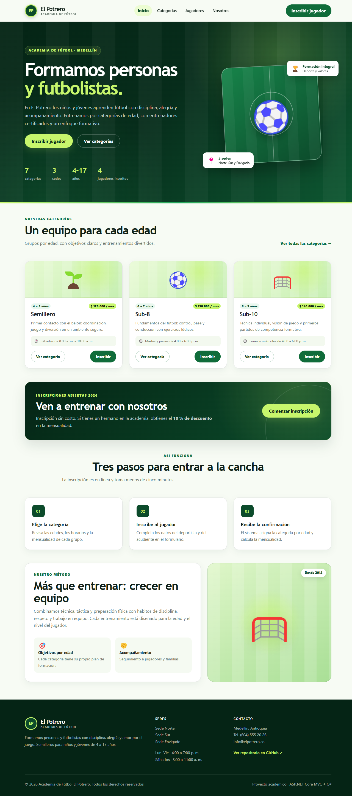
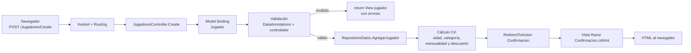
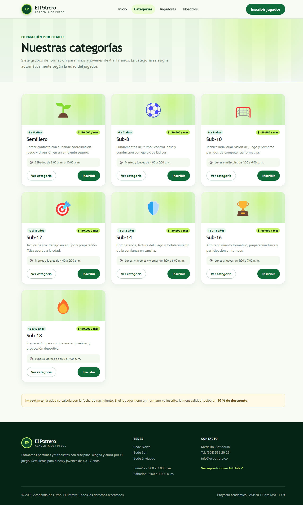
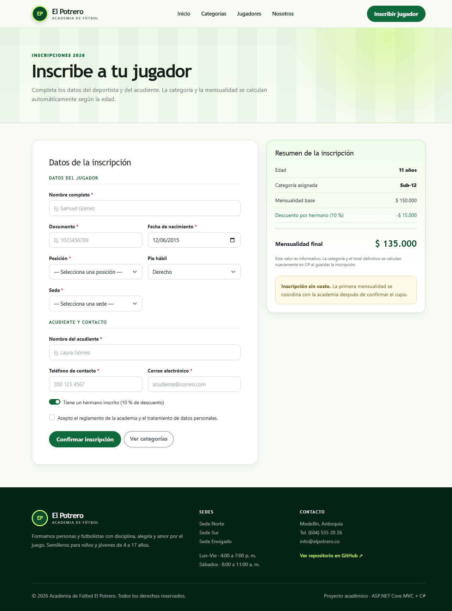
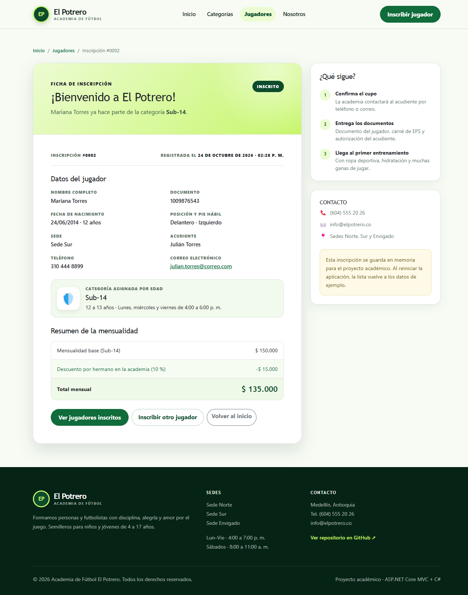
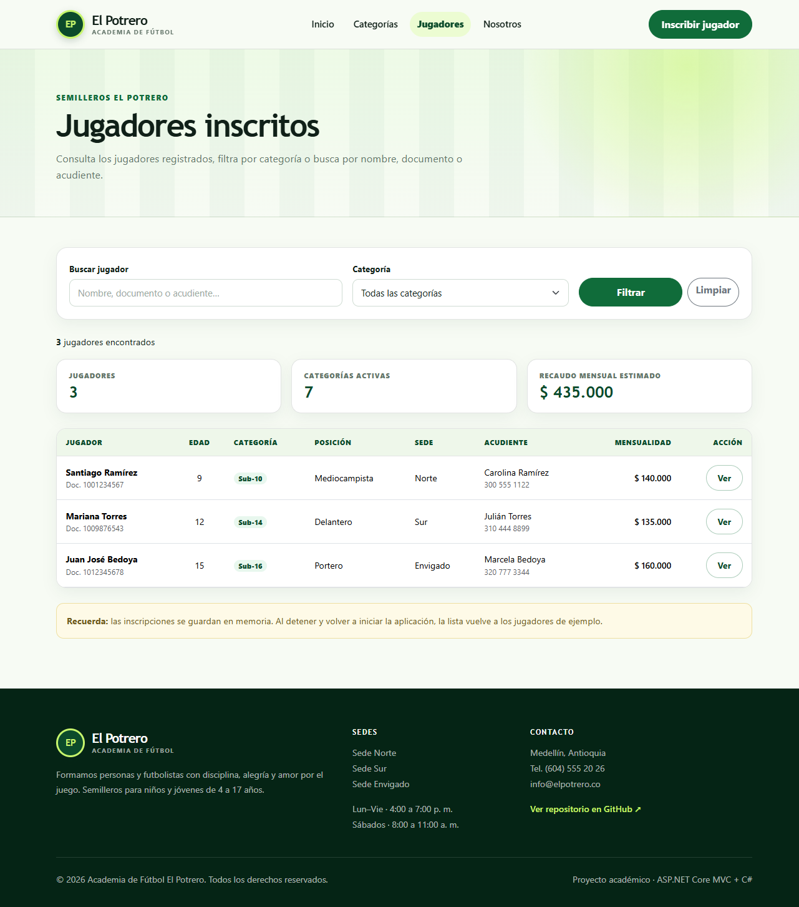
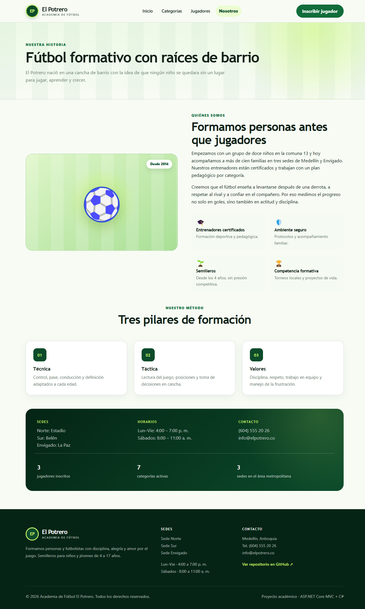

# Academia de Fútbol El Potrero — ASP.NET Core MVC

Aplicación web para una **academia de fútbol formativo**. Es la continuación de la
temática trabajada en los Seguimientos 01 y 02, ahora implementada con
**ASP.NET Core MVC**, **C#** y **Razor**.

El proyecto permite consultar las categorías, inscribir jugadores, asignar la
categoría según la edad y calcular la mensualidad con un descuento por hermano.



## ¿Qué hace la aplicación?

- Muestra una página de inicio con la información de la academia, estadísticas y
  categorías destacadas.
- Lista las **7 categorías** con rango de edad, horario y mensualidad.
- Muestra el detalle de una categoría y los jugadores inscritos en ella.
- Permite **inscribir un jugador** mediante un formulario con validación (POST).
- Calcula en C# la **edad**, la **categoría**, la **mensualidad** y el **descuento
  del 10 %** por hermano.
- Presenta una confirmación con la ficha de inscripción y el resumen de pago.
- Permite consultar los jugadores inscritos y **filtrar por categoría o buscar por
  nombre, documento o acudiente** (GET).
- Incluye una página “Nosotros” con la historia y el método de formación.

> **Alcance académico:** los datos se guardan en memoria (`RepositorioDatos`), por
> lo que las inscripciones se reinician al detener la aplicación. No se usa base de
> datos ni pasarela de pagos para mantener el proyecto simple y comprensible.

## Tecnologías

| Tecnología | Uso |
|---|---|
| ASP.NET Core MVC (.NET 10) | Framework web y patrón Modelo–Vista–Controlador |
| C# | Entidades, validaciones, reglas de negocio y cálculo de la mensualidad |
| Razor (`.cshtml`) | Vistas dinámicas con HTML |
| Bootstrap 5.3 | Grillas, formularios, botones y componentes responsivos |
| CSS propio | Identidad visual de la academia (verde, lima y blanco) |
| JavaScript | Resumen dinámico de la inscripción y menú móvil |
| Git y GitHub | Control de versiones e historial de cambios |
| Docker / IIS | Alternativas de publicación |

## Estructura del proyecto

```
AcademiaFutbolMVC/
├── Controllers/
│   ├── HomeController.cs        → Inicio, Nosotros y página de error
│   ├── CategoriasController.cs  → Listado y detalle de categorías
│   └── JugadoresController.cs   → Lista, formulario GET/POST y confirmación
├── Models/
│   ├── Categoria.cs             → Entidad de categoría deportiva
│   ├── Jugador.cs               → Entidad de inscripción y validaciones
│   ├── RepositorioDatos.cs      → Datos en memoria y cálculo en C#
│   └── ErrorViewModel.cs        → Modelo de la página de error
├── Views/
│   ├── Home/                    → Index.cshtml, Nosotros.cshtml
│   ├── Categorias/              → Index.cshtml, Details.cshtml
│   ├── Jugadores/               → Index.cshtml, Create.cshtml, Confirmacion.cshtml
│   └── Shared/                  → _Layout.cshtml, _CategoriaCard.cshtml, Error.cshtml
├── wwwroot/
│   ├── css/site.css             → Estilos propios
│   ├── js/inscripcion.js        → Resumen dinámico del formulario
│   ├── js/site.js               → Comportamiento general
│   ├── favicon.svg              → Icono de la academia
│   └── lib/                     → Bootstrap, jQuery y validación del cliente
├── docs/capturas/               → Evidencias visuales
├── Program.cs                   → Configuración y cultura es-CO
├── Dockerfile                   → Publicación con Docker
├── render.yaml                  → Configuración para Render
├── DEPLOY.md                    → Guía de publicación
└── GUION_VIDEO.md               → Guion para la sustentación en Teams
```

### Responsabilidad de cada capa

- **Models:** representan los datos y las reglas de validación. `Categoria` y
  `Jugador` son las entidades; `RepositorioDatos` simula la persistencia y calcula
  la categoría y la mensualidad.
- **Views:** reciben el modelo desde el controlador y generan el HTML con Razor.
  No contienen lógica de negocio; solo presentación.
- **Controllers:** reciben la solicitud, leen los datos del formulario o de la URL,
  validan, llaman al modelo y eligen la vista o redirección que se devuelve.

## Entidades principales

### `Categoria`

| Propiedad | Tipo | Descripción |
|---|---|---|
| `Id` | `int` | Identificador |
| `Nombre` | `string` | Nombre de la categoría (Semillero, Sub-8, etc.) |
| `EdadMinima` / `EdadMaxima` | `int` | Rango de edad |
| `Mensualidad` | `decimal` | Valor mensual |
| `Descripcion` | `string` | Objetivo formativo |
| `Horario` | `string` | Días y horas de entrenamiento |
| `Icono` | `string` | Icono decorativo |
| `RangoEdad` | `string` | Propiedad calculada: “8 a 9 años” |

### `Jugador`

| Propiedad | Tipo | Descripción |
|---|---|---|
| `Id` | `int` | Número de inscripción |
| `NombreCompleto` | `string` | Nombre del deportista |
| `Documento` | `string` | Documento de identidad |
| `FechaNacimiento` | `DateTime?` | Fecha de nacimiento |
| `Posicion` | `Posicion?` | Portero, Defensa, Mediocampista o Delantero |
| `PieHabil` | `PieHabil` | Derecho, Izquierdo o Ambidiestro |
| `Sede` | `Sede?` | Norte, Sur o Envigado |
| `Acudiente` | `string` | Nombre del acudiente |
| `Telefono` | `string` | Teléfono de contacto |
| `Correo` | `string` | Correo electrónico |
| `TieneHermanoEnAcademia` | `bool` | Activa el descuento del 10 % |
| `AceptaTerminos` | `bool` | Aceptación del reglamento |
| `FechaRegistro` | `DateTime` | Fecha y hora de la inscripción |
| `Edad` | `int` | Edad calculada en C# |
| `CategoriaId` / `Categoria` | `int` / `Categoria` | Categoría asignada |
| `MensualidadBase` | `decimal` | Valor de la categoría |
| `Descuento` | `decimal` | Descuento por hermano |
| `MensualidadFinal` | `decimal` | Total mensual |
| `Estado` | `string` | Estado de la inscripción |

### `RepositorioDatos`

Contiene las categorías y los jugadores de ejemplo. Sus métodos principales son:

- `CalcularEdad(DateTime fechaNacimiento)`: calcula los años cumplidos.
- `BuscarCategoriaPorEdad(int edad)`: busca la categoría que corresponde.
- `AgregarJugador(Jugador jugador)`: asigna categoría, mensualidad y descuento.
- `ObtenerJugadores(int? categoriaId, string? buscar)`: filtra la lista.
- `ObtenerJugadoresPorCategoria(int categoriaId)`: alimenta el detalle.

## Rutas principales

| Método | Ruta | Acción |
|---|---|---|
| GET | `/` | Página de inicio |
| GET | `/Categorias` | Listado de categorías |
| GET | `/Categorias/Details/3` | Detalle de la categoría Sub-10 |
| GET | `/Jugadores` | Lista de jugadores inscritos |
| GET | `/Jugadores?categoriaId=5` | Filtra por categoría |
| GET | `/Jugadores?buscar=mariana` | Busca por nombre, documento o acudiente |
| GET | `/Jugadores/Create` | Formulario de inscripción |
| POST | `/Jugadores/Create` | Procesa y registra la inscripción |
| GET | `/Jugadores/Confirmacion/2` | Ficha de una inscripción |
| GET | `/Home/Nosotros` | Historia y método de la academia |

## Cómo ejecutar

Requisitos: [.NET SDK 10](https://dotnet.microsoft.com/download) y Git.

```bash
git clone https://github.com/juankekesyt-collab/academia-el-potrero-mvc.git
cd academia-el-potrero-mvc
dotnet restore
dotnet run
```

Abrir la URL que muestra la consola (por ejemplo `http://localhost:5186`).

Para compilar en modo Release:

```bash
dotnet build -c Release
dotnet publish -c Release -o publish
```

## Recorrido de una solicitud



1. El usuario envía el formulario desde `Views/Jugadores/Create.cshtml`.
2. El routing de ASP.NET Core dirige la petición a `JugadoresController.Create`.
3. El **model binding** convierte los campos del formulario en un objeto `Jugador`.
4. Las **DataAnnotations** y las validaciones del controlador revisan los datos.
5. Si todo está correcto, `RepositorioDatos.AgregarJugador` calcula en C# la edad,
   la categoría, la mensualidad y el descuento.
6. El controlador redirige a `Confirmacion` (patrón Post/Redirect/Get).
7. La vista Razor genera el HTML de la ficha y el navegador lo muestra.

## Validaciones implementadas

- Nombre del jugador obligatorio, entre 5 y 100 caracteres.
- Documento obligatorio, entre 6 y 12 números.
- Fecha de nacimiento obligatoria, no futura y con edad entre 4 y 17 años.
- Posición y sede obligatorias.
- Acudiente obligatorio, entre 5 y 100 caracteres.
- Teléfono obligatorio con formato permitido.
- Correo obligatorio y con formato válido.
- Aceptación obligatoria del reglamento (validada en el controlador).
- Token antiforgery en el formulario POST.

## Regla de negocio en C#

```csharp
var edad = CalcularEdad(jugador.FechaNacimiento.Value);
var categoria = BuscarCategoriaPorEdad(edad)
    ?? throw new InvalidOperationException("No hay una categoría disponible para esa edad.");

jugador.Edad = edad;
jugador.CategoriaId = categoria.Id;
jugador.Categoria = categoria;
jugador.MensualidadBase = categoria.Mensualidad;
jugador.Descuento = jugador.TieneHermanoEnAcademia
    ? decimal.Round(categoria.Mensualidad * 0.10m, 0)
    : 0m;
jugador.MensualidadFinal = jugador.MensualidadBase - jugador.Descuento;
```

El JavaScript de `wwwroot/js/inscripcion.js` muestra un resumen preliminar, pero el
servidor vuelve a calcular todos los valores antes de guardar.

## Capturas

| Inicio | Categorías |
|---|---|
|  |  |

| Formulario | Confirmación |
|---|---|
|  |  |

| Jugadores | Nosotros |
|---|---|
|  |  |

## Publicación

La aplicación está preparada para publicarse en un servicio con soporte para
.NET 10 o mediante Docker. El paso a paso está en [`DEPLOY.md`](DEPLOY.md).

**URL pública temporal (demostración):**
<https://resist-amounts-mobiles-tax.trycloudflare.com>

> Esta URL funciona mientras la aplicación y el túnel de Cloudflare estén
> abiertos. Sirve para mostrar el proyecto en el video o en una revisión rápida.
> Para la entrega definitiva hay que publicar en Render, MonsterASP o Azure y
> actualizar este enlace y el campo “Website” del repositorio en GitHub.

## Git y GitHub

Conceptos usados en el proyecto:

- **Commit:** guarda un cambio local con un mensaje descriptivo.
- **Push:** sube los commits locales al repositorio remoto de GitHub.
- **Pull:** trae e integra los cambios que están en el repositorio remoto.

```bash
# Después de modificar archivos
git status
git add .
git commit -m "feat: agregar validación al formulario de inscripción"
git push origin main

# Para actualizar el proyecto local con cambios remotos
git pull origin main
```

El repositorio incluye un historial de commits que muestra la construcción del
proyecto por etapas: estructura inicial, modelos, controladores, vistas, estilos,
formulario y documentación.

## Lista de verificación de la entrega

- [x] ASP.NET Core MVC con Models, Views, Controllers y wwwroot separados.
- [x] Entidades C# con propiedades y tipos de datos (`Categoria`, `Jugador`).
- [x] Controladores, vistas Razor, HTML, Bootstrap y JavaScript.
- [x] Funcionalidad del tema con formulario, acciones GET/POST y procesamiento C#.
- [x] Validación del lado del cliente y del servidor.
- [x] Repositorio Git con historial de commits.
- [ ] URL pública permanente (ver `DEPLOY.md`).
- [x] Guion para el video de Teams en `GUION_VIDEO.md`.

## Autor

Proyecto académico de **@juankekesyt-collab** — ASP.NET Core MVC y C#.
